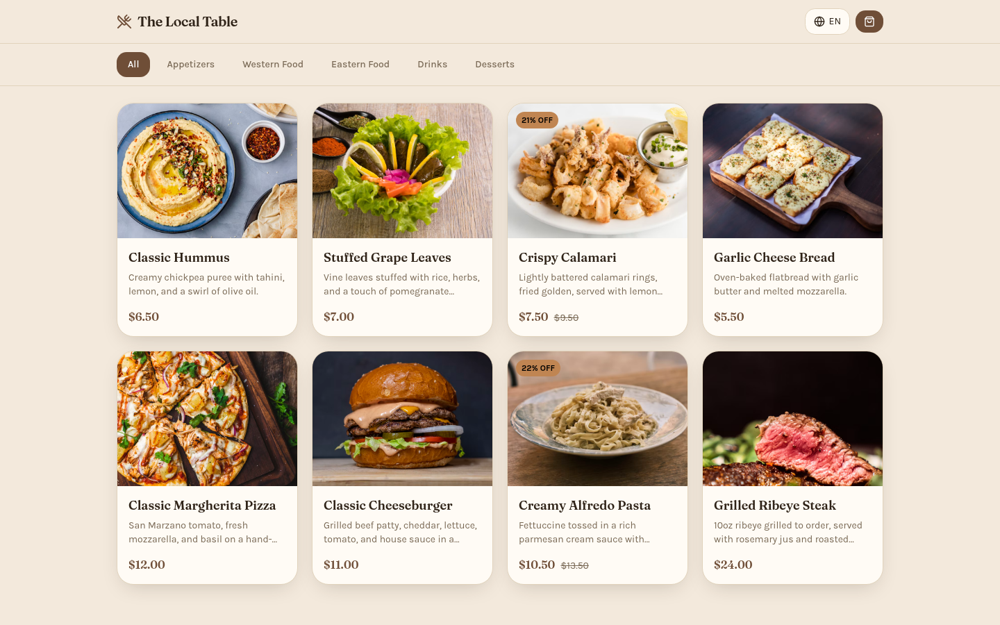
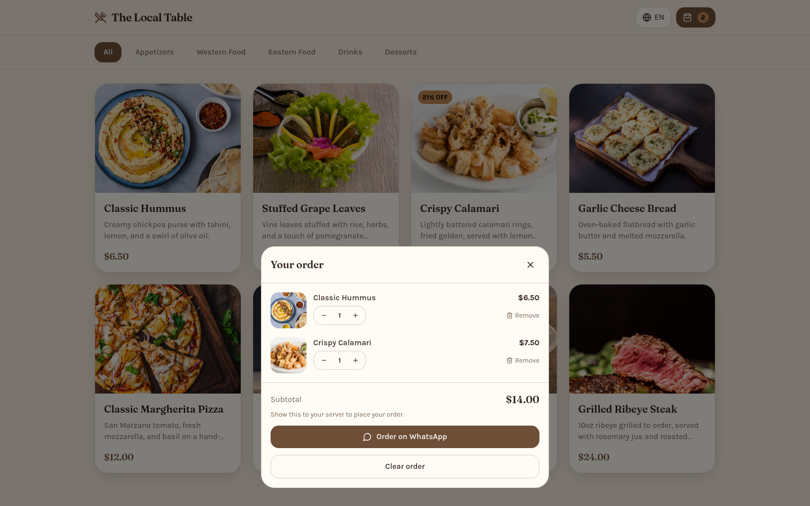
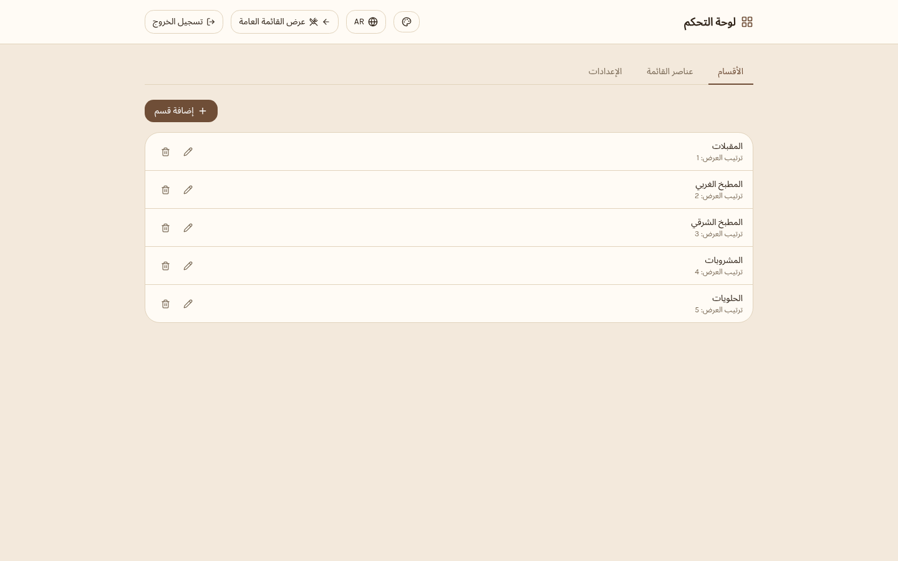

# Restaurant Menu SaaS: White-Label Digital Menu Platform

A multi-tenant digital menu platform for restaurants and cafes. One backend and one frontend build serve any number of restaurants. Each restaurant has its own domain, branding, menu, and admin panel. Customers browse the menu in **English, Arabic (RTL), or Turkish**, add items to a cart, and send the order to the restaurant on **WhatsApp** in one tap.

<!-- Screenshots: add images to docs/screenshots/ and they will render below -->
| Menu | Cart & WhatsApp order | Admin panel |
|---|---|---|
|  |  |  |

## Features

### Customers

- Browse a mobile-first menu with category filters and item detail modals
- Switch between English, Arabic (full right-to-left layout), and Turkish
- Build a cart, then send a pre-filled order message to the restaurant on WhatsApp. The message is written in the restaurant's chosen language, not the customer's
- Pick a visual style: Warm Cafe, Modern Fast Food, or Luxury Dining

### Restaurant admins

- Log in to a separate admin panel for each restaurant (JWT + bcrypt)
- Create, edit, and delete categories and menu items, with per-language name and description tabs
- Upload item photos straight to Cloudflare R2
- Edit branding and settings: name, colors, contact info, WhatsApp number, order language

### Platform

- **Multi-tenancy:** a shared schema with a `tenant_id` on every tenant table. The tenant is resolved from the request's domain, subdomain, or an `X-Tenant-Slug` header
- **White-labeling:** the branding (title, favicon, colors) loads before React mounts, so the page never flashes default branding
- **Tenant-scoped auth:** an admin token issued for one restaurant is rejected on any other restaurant's domain
- **Platform API** to onboard new restaurants and manage their branding

## Tech Stack

| Layer | Technologies |
|---|---|
| Frontend | React 18, Vite, Tailwind CSS, React Router, i18next, Framer Motion, Axios |
| Backend | Python, FastAPI, SQLModel (SQLAlchemy + Pydantic) |
| Database | PostgreSQL (SQLite fallback for local development) |
| Auth | JWT (PyJWT), bcrypt |
| Storage | Cloudflare R2 (S3-compatible, via boto3) |
| DevOps | Docker, Docker Compose, Nginx, Fly.io config |

## Project Structure

```text
backend/
  app/
    main.py            FastAPI app, CORS, router registration
    models.py          Tenant, Category, MenuItem (SQLModel tables)
    schemas.py         Request/response models
    crud.py            Tenant-scoped database queries
    auth.py            Admin login, JWT issue/verify, tenant check
    dependencies.py    Tenant resolution from Host / X-Tenant-Slug
    routers/           menu (public), tenant (config), admin, platform
    services/storage.py  Cloudflare R2 uploads
  seed.py              Two demo restaurants with full menus
frontend/
  src/
    pages/             MenuPage, AdminPage
    components/        menu/, admin/, common/
    context/           Tenant, Theme, Cart (React Context)
    i18n/              en / ar / tr translations
    styles/themes.js   Visual style presets
    utils/whatsappOrder.js  Builds the wa.me order link
```

## Getting Started

### Option 1: Docker (recommended)

```bash
docker compose up --build
```

This starts PostgreSQL, the API, and the frontend, and seeds two demo restaurants.

- Menu: <http://localhost:3000>
- Admin panel: <http://localhost:3000/admin>
- API docs (Swagger): <http://localhost:8000/docs>

### Option 2: Run locally

**Backend** (Python 3.12+):

```bash
cd backend
python -m venv venv && source venv/bin/activate   # Windows: venv\Scripts\activate
pip install -r requirements.txt
cp .env.example .env
python seed.py                  # creates a local SQLite DB with 2 demo restaurants
uvicorn app.main:app --reload   # http://localhost:8000
```

**Frontend** (Node 20+):

```bash
cd frontend
cp .env.example .env            # VITE_TENANT_SLUG picks the demo restaurant
npm install
npm run dev                     # http://localhost:3000
```

### Demo data

| Restaurant | Slug | Admin password |
|---|---|---|
| The Local Table | `local-table` | `admin123` |
| Sunset Diner | `sunset-diner` | `admin123` |

Set `VITE_TENANT_SLUG` to the other slug and restart the dev server to see the second restaurant's menu, colors, and content. The demo password comes from `DEMO_ADMIN_PASSWORD` and is meant for local use only.

## Configuration

Key backend environment variables (see `backend/.env.example`):

| Variable | Purpose |
|---|---|
| `DATABASE_URL` | PostgreSQL connection string (SQLite is used if unset) |
| `JWT_SECRET` | Signs admin tokens. Always set a long random value outside development |
| `PLATFORM_ADMIN_KEY` | Shared secret for the tenant-onboarding platform API |
| `CORS_ORIGINS` | Allowed browser origins, comma-separated (default `*`) |
| `TENANT_DEV_FALLBACK` | Serves the first tenant for unknown domains. Set to `false` in production |
| `R2_*` | Cloudflare R2 credentials for image uploads (uploads return 503 if unset) |

More detail on tenant resolution, image uploads, the branding loader, custom domains, and adding a language: [docs/ARCHITECTURE.md](docs/ARCHITECTURE.md).

## Roadmap

- Staff accounts for the platform API (it currently uses a shared secret)
- Automated tests
- Online ordering and payments beyond WhatsApp

## Author

**Ammar Alaee**, Electronics & Communication Engineering student at Yıldız Technical University
[LinkedIn](https://www.linkedin.com/in/ammar-alaee) · [GitHub](https://github.com/I3mk132)
